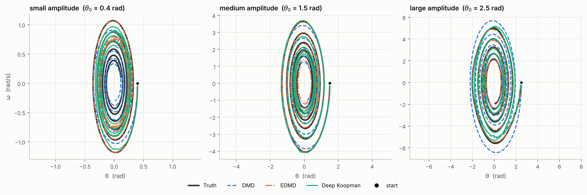
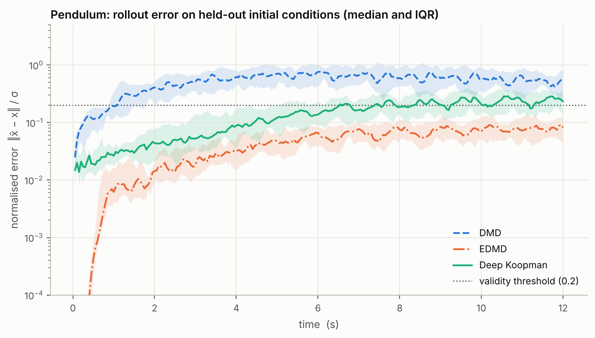
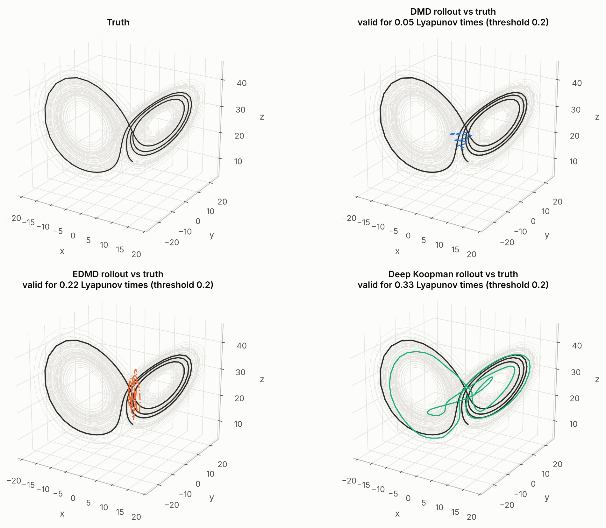
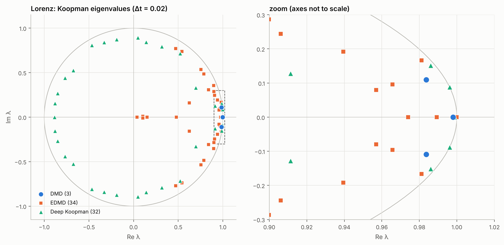

# Koopman operator learning for nonlinear dynamics

DMD, EDMD and Deep Koopman on the damped nonlinear pendulum and the Lorenz attractor.

A small Python library (NumPy, SciPy, PyTorch, Matplotlib, pytest) that approximates the Koopman operator — an
infinite-dimensional *linear* operator acting on functions of the state — with finite-dimensional models:

| Method | What it is | Module |
|---|---|---|
| Custom ODE solvers | Euler, RK4, adaptive Dormand–Prince 5(4) used to generate data | `koopman/solvers.py` |
| Exact DMD | rank-truncated SVD, modes, eigenvalues, amplitudes | `koopman/dmd.py` |
| EDMD | dictionary lifting + ridge least squares; physics-informed pendulum dictionary `{ω^p sin kθ, ω^p cos kθ, ω^p}` and polynomial dictionaries for Lorenz | `koopman/edmd.py`, `koopman/observables.py` |
| Deep Koopman | autoencoder with a linear latent map, trained with reconstruction + linearity + multi-step prediction losses (Lusch et al., 2018) | `koopman/deep_koopman.py` |
| Visualisation | colour-blind-safe figure functions | `koopman/viz.py` |

## Quick start

```bash
pip install -r requirements.txt
pytest                      # unit tests + end-to-end smoke tests
python main.py              # both experiments -> results/figures, results/*_metrics.json
python main.py --quick      # a short smoke run
python main.py --system pendulum   # or lorenz
```

The report (`report/koopman_report.tex`, compiled `report/koopman_report.pdf`) explains the theory, the protocol and
how to read every figure. Rebuild it with `python report/make_tables.py && cd report && pdflatex koopman_report.tex`.

## Evaluation protocol

Every model predicts a *whole* trajectory from its **initial state alone** on **held-out** initial conditions;
hyper-parameters are chosen on a separate validation set. Errors are normalised by the spread of the training states;
the *valid prediction time* is when the normalised error first exceeds 0.2 (Lorenz time is in Lyapunov times).

## Results (seed 0, single run)

Pendulum (30 test trajectories, 12 s horizon; ≥ means capped by the horizon):

| Method | mean error | median valid time | one-step RMSE |
|---|---|---|---|
| DMD | 0.624 | 1.10 s | 3.9e-2 |
| EDMD | 0.064 | ≥ 12.00 s (87 % of runs never exceed 0.2) | 1.4e-6 |
| Deep Koopman | 0.197 | 6.12 s | 2.5e-2 |

Lorenz (46 test initial states):

| Method | mean error | median valid time (Lyapunov times) | one-step RMSE |
|---|---|---|---|
| DMD | 1.066 | 0.05 | 1.04 |
| EDMD | 0.782 | 0.20 | 1.1e-3 |
| Deep Koopman | 0.952 | 0.44 | 0.78 |

Lorenz is chaotic: every finite linear Koopman model fails within a fraction of a Lyapunov time, so these numbers
show relative behaviour, not long-term forecasting.






## Caveats

Single seed and no confidence intervals; Deep Koopman was tuned on a modest grid; the EDMD error depends on the
parity of the velocity degree and the cause was not investigated; the Deep Koopman Lorenz operator needed a
validation-selected eigenvalue stabilisation. See the report for details.

## Note on the earlier version of this repository

The first version compared methods by reconstruction on training data. This version replaces it with rollouts from
the initial state on held-out data, adds the custom solvers, exact SVD-based DMD, physics-informed EDMD, the
multi-step Deep Koopman losses and a test suite.

## References

Koopman (1931); Schmid (2010); Tu et al. (2014); Williams, Kevrekidis & Rowley (2015); Lusch, Kutz & Brunton (2018);
Brunton et al. (2022); Dormand & Prince (1980); Lorenz (1963).
